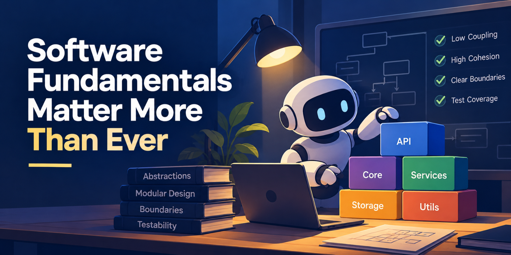

The fundamental rules of software design are now more important than ever in the age of agents, especially now that we are no longer looking at most of the code ourselves.

I have worked on very large codebases, many of which were bad for humans to work on. If you need to change one part of a codebase and it could break functionality somewhere else, making that change becomes difficult. With agents, this problem could becomes even worse as if things keep breaking, the trust you have in the code they produce will be very low.

Codebases built on strong fundamentals, abstractions, and design principles work very well with agents. By strong fundamentals, I mean clear abstractions, well-defined boundaries, low coupling, and good test coverage. Every part of the codebase should be easy to understand, change, verify, and remove without unexpectedly breaking something elsewhere. You should be able to reason about a change locally and trust that its impact will be limited to the area you're working on.

I'm not talking about clean code. Clean code is not as important as it used to be in an era where we no longer read most of the code ourselves. A codebase might not always be pretty to look at, but it should be fundamentally strong. Its abstractions should make sense, its boundaries should be well-defined, and changes should be easy to verify without breaking unrelated functionality. How the code looks matters less than how safely and predictably it can evolve.

I genuinely believe that refactoring a codebase is the best way to get better results from agents, rather than relying on skills or plugins built for them.

The cost of refactoring has never been lower. Imagine taking an entire codebase, studying it with agents, breaking it down into well-defined parts, and creating a proper specification for how each of those parts should be reimplemented. That work can be done in weeks, if not days, with current models.

Going forward, if that work is done properly, the codebase will be much easier to build upon, and your team's efficiency will go up astronomically. You can add new functionality, experiment with different approaches, and remove things that don't work, all while having greater confidence that the changes won't break unrelated parts of the system.

If your codebase is easy for a new developer on your team to work with, it will be easy for agents to work with, too.